# Dataset y LoRA de estilo a partir de un video de 9 horas

> **English summary:** an end-to-end pipeline that turns a 9-hour 4K gameplay video into a curated, captioned image dataset and trains a style LoRA for the Qwen-Image 2512 diffusion model, all on a single 12 GB consumer GPU. A local vision-language model (Qwen2.5-VL 7B) filters 5,181 candidate frames and writes the captions, and a manual review step catches what the model misses.

Proyecto personal: enseñarle a un modelo de generación de imágenes (Qwen-Image 2512) a dibujar escenarios con el estilo visual de *Pokémon Let's Go Pikachu/Eevee*. Lo uso para crear fondos y mapas para partidas de rol en FoundryVTT.

La parte difícil no fue entrenar, sino **conseguir buenos datos**: de un longplay de 9 horas hay que quedarse solo con las vistas limpias del mundo (sin combates, menús, diálogos ni primeros planos) y describir cada imagen con texto.

## Pipeline

```mermaid
flowchart LR
    A[Video 4K, 9 h] -->|ffmpeg, keyframes cada 4 s| B[8.247 frames]
    B -->|filtros numéricos:<br/>brillo, nitidez, dHash| C[5.181 candidatas]
    C -->|Qwen2.5-VL: ¿vista limpia? YES/NO| D[1.381 aceptadas]
    D -->|raleo + revisión manual| E[484 imágenes]
    E -->|Qwen2.5-VL: caption| F[484 imágenes + texto]
    F -->|musubi-tuner, 4 épocas| G[LoRA de estilo]
```



| Paso | Script | Qué hace |
|---|---|---|
| 1. Extracción | `pipeline/extraer.py` | Descarga el video con yt-dlp, extrae solo keyframes con ffmpeg (separados ≥4 s) y recorta la marca de agua |
| 2. Filtro barato | `pipeline/extraer.py filtrar` | Sin IA: descarta fundidos a negro o blanco, frames borrosos (varianza del laplaciano) y casi duplicados (dHash de 64 bits, distancia de Hamming ≤ 6) |
| 3. Filtro con VLM | `pipeline/vlm.ps1 filtro` | Qwen2.5-VL 7B en fp8 responde YES/NO a "¿es una vista limpia del mundo?". Con `max_new_tokens 4` procesa unas 2 imágenes por segundo |
| 4. Selección | `pipeline/seleccionar.py` | Máximo 1 frame cada ~20 s de juego (para que las zonas largas no dominen), sin fundidos y sin los descartes de la revisión manual |
| 5. Revisión humana | `pipeline/hoja.py` | Hojas de contacto de 40 miniaturas para revisar a ojo |
| 6. Captions | `pipeline/vlm.ps1 captions` + `captions.py` | Descripción de cada imagen con Qwen2.5-VL y una palabra clave (`lgpestyle`) al inicio para activar el estilo |
| 7. Entrenamiento | `entrenamiento/entrenar.ps1` | LoRA rango 16 sobre Qwen-Image 2512 con musubi-tuner |

## Resultados

- **Datos:** de 8.247 frames a **484 imágenes** revisadas y descritas.
- **Entrenamiento:** 1.936 pasos en **4 h 01 min** en una RTX 4070 SUPER de 12 GB. La pérdida media final fue 0,113. Se guardó un checkpoint por época para compararlas.
- **Efecto:** el LoRA cambia el aspecto brillante y de alto contraste del modelo base por la luz suave y mate de Let's Go. La época 4 es la más fiel al juego.

## Ampliación por zonas (`pipeline/mineria/`)

Después del primer entrenamiento, un análisis de palabras clave sobre los captions mostró qué faltaba: había unas 135 imágenes de rutas, pero solo 12 de cuevas, ninguna del casino y casi ninguna de la guarida del Team Rocket.

1. `linea_tiempo.py` arma hojas de miniaturas a lo largo de todo el video, con un borde de color según lo que decidió el VLM. Con ellas ubiqué cada zona del juego por número de frame (`zonas.json`).
2. Así descubrí que **el VLM había rechazado casi todas las cuevas oscuras**: confundía la penumbra con "no es una vista limpia". Esas zonas las elegí a mano (`hojas_zona.py`, `seleccion.py`).
3. Los frames con un cuadro de diálogo se recortan para conservar solo la parte de arriba, en vez de descartarlos.
4. `captions_extra.py` añade el nombre de la zona a cada caption ("Rock Tunnel", "Team Rocket Hideout"…) para poder pedirla desde el prompt.

Resultado: **306 imágenes nuevas** de 14 zonas. Las cuevas pasan de 12 a unas 100.

## Lo que no funcionó (y qué aprendí)

- **Clasificar con CLIP** (zero-shot, comparando la imagen con textos como "vista del mundo" o "combate") no distinguía bien los tipos de pantalla. Un VLM al que se le hace una pregunta concreta funcionó mucho mejor.
- **Preguntarle al VLM por la altura de la cámara** no sirvió: respondía "LOW" a casi todo. Algunas preguntas visuales necesitan revisión humana, así que la incorporé como un paso más del pipeline.
- **Los VLM inventan texto:** en los captions aparecían letreros que no existen ("POKE STOP", "UCAB 1999"). Si se entrena con eso, el modelo aprende a dibujar letras deformes. `captions_extra.py` elimina con una expresión regular las frases sobre texto en pantalla.
- **Los filtros automáticos tienen sesgos** (el caso de las cuevas oscuras). Revisar *qué* rechaza un filtro importa tanto como revisar lo que acepta.

## Cómo ejecutarlo

Requisitos: Python 3, ffmpeg, [uv](https://github.com/astral-sh/uv) (para yt-dlp), [musubi-tuner](https://github.com/kohya-ss/musubi-tuner) con su entorno, y los pesos de Qwen-Image 2512 y Qwen2.5-VL 7B. GPU de 12 GB o más.

```powershell
cd pipeline
pip install numpy pillow
python extraer.py                      # descargar + frames + filtro barato
.\vlm.ps1 filtro -Musubi C:\musubi-tuner
python seleccionar.py                  # -> dataset/
python hoja.py dataset                 # revisar; anotar descartes en descartes_manual.txt
.\vlm.ps1 captions -Musubi C:\musubi-tuner
python captions.py
cd ..\entrenamiento                    # editar las rutas de dataset.toml
.\entrenar.ps1 -Prueba                 # 10 pasos para medir memoria
.\entrenar.ps1
```

## Stack

Python · NumPy · Pillow · ffmpeg · yt-dlp · Qwen2.5-VL 7B (fp8) · Qwen-Image 2512 · musubi-tuner · PowerShell · ComfyUI (para usar el LoRA)

## Nota legal

Este repositorio contiene **solo código**. No incluye el video, los frames, el dataset ni el LoRA entrenado: son material de un juego con copyright (© Nintendo / Game Freak / The Pokémon Company). El proyecto es personal y sin fines comerciales.

Desarrollado con ayuda de Claude Code como asistente de programación.
